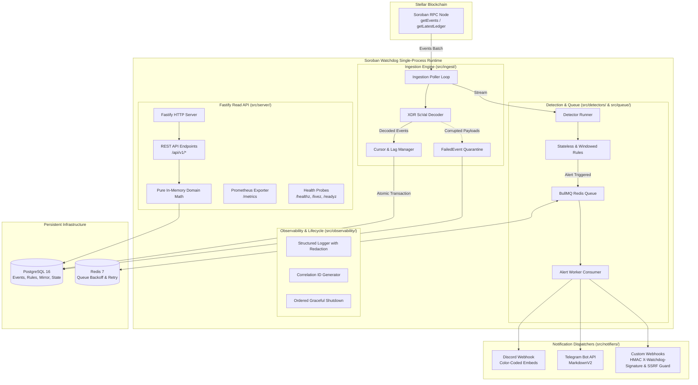

# 🛡️ Soroban Watchdog Backend

> **Enterprise-grade Telemetry, Anomaly Surveillance & Exploit-Alerting Engine for Stellar Soroban Smart Contracts.**

[](https://opensource.org/licenses/Apache-2.0)
[](https://stellar.org/soroban)
[](https://nodejs.org/)
[](https://www.typescriptlang.org/)
[](https://vitest.dev/)
[](https://drips.network)

---

## 📖 Table of Contents

- [1. Executive Overview](#1-executive-overview)
- [2. What Makes This Codebase Exceptional](#2-what-makes-this-codebase-exceptional)
- [3. Architecture & Dual-Engine Topology](#3-architecture--dual-engine-topology)
- [4. How It Works: Deep Dive](#4-how-it-works-deep-dive)
  - [Idempotent Cursor Management & Lag Bookkeeping](#idempotent-cursor-management--lag-bookkeeping)
  - [Dead-Letter Quarantine & Recovery](#dead-letter-quarantine--recovery)
  - [Zero-Chain-Roundtrip Domain Math](#zero-chain-roundtrip-domain-math)
  - [Ordered Graceful Shutdown Sequence](#ordered-graceful-shutdown-sequence)
- [5. Production Observability & Prometheus Metrics](#5-production-observability--prometheus-metrics)
- [6. REST API Reference](#6-rest-api-reference)
- [7. Database Schema Overview](#7-database-schema-overview)
- [8. Security & Cryptographic Safeguards](#8-security--cryptographic-safeguards)
- [9. Configuration Reference](#9-configuration-reference)
- [10. Local Development & Docker](#10-local-development--docker)
- [11. Testing & Verification](#11-testing--verification)
- [12. Repository Directory Structure](#12-repository-directory-structure)
- [13. Operational Runbooks & Troubleshooting](#13-operational-runbooks--troubleshooting)

---

## 1. Executive Overview

Decentralized applications on Stellar Soroban require continuous, sub-second telemetry and threat surveillance. When an automated market maker experiences abnormal capital drainage, sudden flash-loan manipulation, or unexpected emergency contract pause calls, protocol engineers cannot afford to discover the incident minutes or hours later through manual block explorer inspection.

**Soroban Watchdog** provides a robust, push-based surveillance and alerting infrastructure:
- **Continuous Ingestion**: Polls Soroban RPC `getEvents` with strictly forward-moving cursors and automated ledger gap detection.
- **Precision Decoding**: Transforms binary base64 XDR events into strongly typed JavaScript models with 128-bit `BigInt` precision, eliminating floating-point inaccuracies.
- **Pluggable Anomaly Engine**: Evaluates events against modular **Stateless** (single-event value thresholds, emergency pause triggers) and **Windowed** (cumulative drain rates, transaction failure surges) detector plugins.
- **Cryptographic & SSRF-Hardened Delivery**: Fans out alerts via **BullMQ** on **Redis** with exponential backoff across **Discord** (color-coded embed messages), **Telegram** (Markdown alerts), and **Custom Webhooks** (HMAC-SHA256 signed with `X-Watchdog-Signature` and protected by strict SSRF IP filters).
- **Zero-Chain-Roundtrip Read API**: Serves high-throughput contract telemetry and frequency analytics from a local PostgreSQL mirror using pure in-memory domain math.

---

## 2. What Makes This Codebase Exceptional

1. **Dual-Engine Single-Process Architecture**:
   - **Ingestion Engine (`src/ingest/poller.ts`)**: Ingests Soroban events with an idempotent cursor and updates the PostgreSQL mirror in atomic transactions.
   - **Read API (`src/server/server.ts`)**: Fastify 4.x service that serves zero-chain-roundtrip queries, calculating derived fields on the fly using pure domain math (`src/lib/domainMath.ts`).
2. **Resilience & Idempotency**:
   - `lastEventId` ordering to eliminate race conditions on event replay.
   - Dedicated `FailedEvent` dead-letter quarantine table with CLI recovery tools (`npm run replay-failed-events`, `npm run prune-failed-events`).
   - Single-row bookkeeping table (`IngestionState`) tracking cursor, applied block height (`lastLedgerSequence`), and chain head (`chainLedger`) to compute real-time poller lag.
3. **Production Observability & Lifecycle**:
   - Full Prometheus metrics registry (`/metrics`) tracking poller lag, tick durations, error frequencies, and HTTP response latencies.
   - Correlation IDs (`x-request-id`) injected and propagated across all incoming requests and structured Pino logs.
   - Deep recursive credential redaction (`src/observability/errorRedaction.ts`) safeguarding database URLs, Bearer tokens, and secrets.
   - Ordered graceful shutdown sequence (`src/observability/shutdown.ts`):
     $$\text{Stop Poller} \longrightarrow \text{Drain Queue Worker} \longrightarrow \text{Close HTTP Listener} \longrightarrow \text{Drain DB Connection Pool} \longrightarrow \text{Exit 0}$$
4. **Documentation Standard**:
   - Exhaustive operational and architectural deep-dive guides in [`docs/`](./docs/):
     [`database-schema.md`](./docs/database-schema.md), [`request-lifecycle.md`](./docs/request-lifecycle.md), [`poll-tick-sequence.md`](./docs/poll-tick-sequence.md), [`failure-modes.md`](./docs/failure-modes.md), [`shutdown-ordering.md`](./docs/shutdown-ordering.md), and [`glossary.md`](./docs/glossary.md).

---

## 3. Architecture & Dual-Engine Topology



---

## 4. How It Works: Deep Dive

### Idempotent Cursor Management & Lag Bookkeeping
The poller tracks the ledger height and pagination cursor for each monitored contract in `IngestionState`:
- **Strictly Forward-Moving**: Uses the Soroban RPC cursor (`{ledger}-{txIndex}-{eventIndex}`) to guarantee no events are skipped or double-processed.
- **Real-Time Lag Calculation**:
  $$\text{Poller Lag (Ledgers)} = \max\Big(0, \text{chainLedger} - \text{lastLedgerSequence}\Big)$$
  Lag is emitted continuously to Prometheus (`soroban_poller_lag_ledgers`) and checked on `/readyz`.
- **Atomic Transactions**: Ingestion commits events, cursor updates, and ledger heights in a single interactive PostgreSQL transaction (`db.$transaction`).

### Dead-Letter Quarantine & Recovery
If an upstream smart contract emits malformed or unparseable XDR:
1. The error is intercepted without terminating the poller.
2. The raw payload, contract ID, and error stack trace are quarantined in the `FailedEvent` table.
3. Operators inspect and replay failed events using dedicated CLI tools:
   ```bash
   # Replay pending quarantined events
   npm run replay-failed-events

   # Prune resolved events older than 14 days
   npm run prune-failed-events -- --days=14
   ```

### Zero-Chain-Roundtrip Domain Math
External read requests (`GET /api/v1/telemetry/:contractId`) never query the blockchain RPC:
- All historical events and timestamps are queried from the local PostgreSQL mirror.
- Transfer velocities, volume percentiles, capital outflow ratios, and burst rates are calculated in-memory on the fly via `src/lib/domainMath.ts`.
- Guarantees sub-millisecond API response times with zero upstream RPC rate-limiting risk.

### Ordered Graceful Shutdown Sequence
When receiving `SIGINT` or `SIGTERM`, `GracefulShutdownManager` executes a prioritized shutdown:
1. **Priority 10**: Halt Ingestion Poller (stop pulling new events).
2. **Priority 20**: Drain Alert Queue & Worker (allow active webhook deliveries to complete).
3. **Priority 30**: Close Fastify HTTP Server (stop accepting connections; finish in-flight responses).
4. **Priority 90**: Drain Prisma PostgreSQL Pool & Redis (clean disconnect).
5. **Exit 0**: Clean process termination within 15 seconds.

---

## 5. Production Observability & Prometheus Metrics

Metrics are exported in Prometheus text exposition format on `GET /metrics`:

| Metric Name | Type | Labels | Description |
| :--- | :--- | :--- | :--- |
| `soroban_poller_lag_ledgers` | Gauge | `contract_id` | Real-time poller lag in ledgers (`chainLedger - lastLedger`). |
| `soroban_poller_chain_ledger` | Gauge | `network` | Upstream Soroban blockchain head ledger sequence. |
| `soroban_poller_last_ledger` | Gauge | `contract_id` | Last ledger sequence successfully processed and persisted. |
| `soroban_poller_ticks_total` | Counter | `status` | Total poller tick executions (`success`, `empty`, `error`). |
| `soroban_poller_tick_duration_seconds` | Histogram | - | Duration of poller ingestion tick in seconds. |
| `soroban_events_ingested_total` | Counter | `contract_id`, `event_type` | Total decoded events ingested from the blockchain. |
| `soroban_failed_events_total` | Counter | `contract_id`, `reason` | Total unparseable events quarantined in dead-letter table. |
| `soroban_alerts_triggered_total` | Counter | `rule_id`, `severity` | Total anomaly alerts generated by detector runner. |
| `soroban_alert_deliveries_total` | Counter | `channel_type`, `status` | Total notification dispatches to Discord, Telegram, or Webhook. |
| `soroban_http_requests_total` | Counter | `method`, `route`, `status_code` | Total incoming HTTP requests handled by REST API. |
| `soroban_http_request_duration_seconds` | Histogram | `method`, `route` | Latency distribution of REST API request handling. |

### Recommended Prometheus Alerting Rules
```yaml
groups:
  - name: soroban_watchdog_alerts
    rules:
      - alert: SorobanPollerLagCritical
        expr: soroban_poller_lag_ledgers > 30
        for: 2m
        labels:
          severity: critical
        annotations:
          summary: "Soroban Watchdog is falling behind on contract {{ $labels.contract_id }}"

      - alert: SorobanDeadLetterSpike
        expr: rate(soroban_failed_events_total[5m]) > 0.1
        for: 1m
        labels:
          severity: warning
        annotations:
          summary: "Unparseable Soroban events quarantined in dead-letter table"
```

---

## 6. REST API Reference

All requests and responses use JSON. Unhandled errors conform to **RFC 7807 Problem Details** (`application/problem+json`). Interactive OpenAPI documentation is hosted at `http://localhost:4000/docs`.

### Health & Observability
| Method | Endpoint | Description |
| :--- | :--- | :--- |
| `GET` | `/healthz` | Basic process health check (`{ status: "ok", uptime: ... }`). |
| `GET` | `/livez` | Kubernetes liveness probe with memory statistics. |
| `GET` | `/readyz` | Kubernetes readiness probe (checks PostgreSQL connectivity and poller lag). |
| `GET` | `/metrics` | Prometheus metrics text exposition endpoint. |

### Core Telemetry & Configuration Endpoints
| Method | Endpoint | Description |
| :--- | :--- | :--- |
| `GET` | `/api/v1/contracts` | List all monitored contracts with cursor state, lag, and event counts. |
| `POST` | `/api/v1/contracts` | Register a new Soroban contract for monitoring. |
| `GET` | `/api/v1/contracts/:id` | Get contract details with real-time lag analysis. |
| `PATCH` | `/api/v1/contracts/:id` | Update contract name or toggle active monitoring. |
| `DELETE` | `/api/v1/contracts/:id` | Remove contract from surveillance. |
| `GET` | `/api/v1/rules` | List all configured anomaly detection rules. |
| `POST` | `/api/v1/rules` | Create a detector rule with custom thresholds and parameters. |
| `PATCH` | `/api/v1/rules/:id` | Modify parameters or toggle detector rule status. |
| `DELETE` | `/api/v1/rules/:id` | Delete detector rule. |
| `GET` | `/api/v1/channels` | List notification channels (destinations masked, secrets omitted). |
| `POST` | `/api/v1/channels` | Register notification channel (encrypted at rest using AES-256-GCM). |
| `DELETE` | `/api/v1/channels/:id` | Delete notification channel. |
| `GET` | `/api/v1/alerts` | Paginated query of triggered alerts with filters (`severity`, `ruleId`, `contractId`). |
| `GET` | `/api/v1/alerts/:id` | Retrieve single alert detail with channel delivery logs. |
| `GET` | `/api/v1/telemetry/:contractId` | **Zero-Chain-Roundtrip** in-memory telemetry, velocity, and frequency summary. |
| `GET` | `/api/v1/failed-events` | Query dead-letter quarantined events. |
| `POST` | `/api/v1/failed-events/:id/replay` | Manually re-evaluate and replay a single failed event. |
| `POST` | `/api/v1/failed-events/:id/discard` | Mark a failed event as discarded. |

---

## 7. Database Schema Overview

Built on **PostgreSQL** with **Prisma ORM**. Key tables:
- **`Contract`**: Registered Soroban addresses (`C...`), name aliases, active flags.
- **`IngestionState`**: Single-row cursor marker tracking `cursor`, `lastLedgerSequence`, `chainLedger`, and `lastEventId`.
- **`Event`**: Decoded Soroban events (`{ledger}-{txIndex}-{eventIndex}`), topics, data, and raw base64 XDR.
- **`Rule`**: Detection algorithms (`LARGE_VALUE_TRANSFER`, `RAPID_DRAIN`, `EMERGENCY_PAUSE`), severity, JSON parameters.
- **`Channel`**: Alert delivery endpoints (AES-256-GCM encrypted destinations and secrets).
- **`Alert`**: Triggered security incidents with explorer URLs, severities, and metadata.
- **`AlertDelivery`**: Per-channel dispatch logs tracking delivery status, retry attempts, and error details.
- **`FailedEvent`**: Dead-letter quarantine table for unparseable raw events and error stack traces.

---

## 8. Security & Cryptographic Safeguards

1. **SSRF Guard (`src/notifiers/ssrfValidator.ts`)**:
   - Outgoing custom webhooks validate target URLs before dispatch.
   - Enforces `https://` protocol.
   - Performs asynchronous DNS lookups to block private and loopback subnets:
     `127.0.0.0/8`, `10.0.0.0/8`, `172.16.0.0/12`, `192.168.0.0/16`, `169.254.0.0/16` (Cloud Metadata), `fc00::/7` (IPv6 ULA), and `fe80::/10` (IPv6 Link-Local).
2. **HMAC-SHA256 Cryptographic Signatures**:
   - Custom webhooks include an `X-Watchdog-Signature: sha256=<hex>` header.
   - Recipients verify alert origin authenticity using timing-safe comparisons (`crypto.timingSafeEqual`).
3. **AES-256-GCM Secret Encryption**:
   - Webhook destinations and Telegram bot tokens stored in PostgreSQL are encrypted with unique 96-bit initialization vectors (IV) and 128-bit authentication tags.
4. **Data Redaction**:
   - Structured Pino logs recursively redact credentials, passwords, tokens, and database connection strings before writing to stdout.

---

## 9. Configuration Reference

All settings are validated via **Zod** (`src/config/env.ts`):

| Variable | Type | Default | Required | Description |
| :--- | :--- | :--- | :--- | :--- |
| `NODE_ENV` | String | `development` | No | Runtime environment (`development`, `production`, `test`). |
| `PORT` | Number | `4000` | No | Fastify HTTP port listener. |
| `DATABASE_URL` | String | - | **Yes** | PostgreSQL connection string. |
| `REDIS_URL` | String | - | **Yes** | Redis connection URL for BullMQ. |
| `SOROBAN_RPC_URL` | String | - | **Yes** | Stellar Soroban RPC node endpoint. |
| `ENCRYPTION_KEY` | Hex (64 chars) | - | **Yes** | 32-byte hexadecimal key for AES-256-GCM encryption. |
| `POLL_INTERVAL_MS` | Number | `5000` | No | Milliseconds between poller loop iterations. |
| `MAX_EVENTS_PER_BATCH` | Number | `100` | No | Maximum event limit requested per RPC batch. |
| `MONITOR_CONTRACT_ID` | String | `CDLZFC...` | No | Default Soroban contract monitored on cold start. |
| `LOG_LEVEL` | String | `info` | No | Pino logging level (`debug`, `info`, `warn`, `error`). |

---

## 10. Local Development & Docker

### Local Prerequisites
- Node.js >= 20.12.0
- Docker & Docker Compose

### 1. Start Local Infrastructure
```bash
# Clone the repository
git clone https://github.com/Soroban-Watchtower/soroban-watchtower-backend.git
cd soroban-watchtower-backend

# Copy environment template
cp .env.example .env

# Start PostgreSQL and Redis containers
docker compose up -d postgres redis
```

### 2. Database Migrations & Client Generation
```bash
# Install dependencies
npm install

# Generate Prisma Client and run migrations
npm run prisma:generate
npm run prisma:migrate
```

### 3. Run the Dual-Engine Service
```bash
# Run unified dual-engine runtime in watch mode
npm run dev

# Or run individual processes independently
npm run dev:server   # Fastify Read API only
npm run dev:ingest   # Ingestion Poller only
npm run dev:notify   # BullMQ Alert Worker only
```

### 4. Full Production Stack via Docker Compose
```bash
# Build and run PostgreSQL, Redis, and Watchdog in Docker
docker compose up -d --build
```

---

## 11. Testing & Verification

The test suite is powered by **Vitest** with 100% mocked RPC, Redis, and network fixtures:

```bash
# Run all unit and integration test suites
npm test

# Run tests in watch mode
npm run test:watch

# Run tests with code coverage analysis
npm run test:coverage

# Perform TypeScript static type check
npm run lint

# Step 10: Run End-to-End Simulation & Live Testnet Run
npm run simulate

# Send simulation alert to custom Discord webhook or Webhook.site
npm run simulate -- --webhook="https://discord.com/api/webhooks/<channel-id>/<token>"

# Verify end-to-end alert dispatch via verification tool
npx tsx src/notifiers/verifyDispatch.ts
```

---

## 12. Repository Directory Structure

```text
soroban-watchtower-backend/
├── .env.example                  # Exhaustive environment variable reference
├── .editorconfig                 # Consistent code indentation & formatting standards
├── .gitignore                    # Git tracking ignore rules
├── Dockerfile                    # Multi-stage production container build (non-root)
├── docker-compose.yml            # PostgreSQL, Redis, and full stack local orchestration
├── package.json                  # Scripts, strict dependencies, and project metadata
├── tsconfig.json                 # Strict TypeScript configuration
├── vitest.config.ts              # Vitest test runner configuration
├── prisma/
│   ├── schema.prisma             # Production PostgreSQL schema with composite indexes
│   └── migrations/               # Versioned SQL migration files
├── docs/                         # Comprehensive architectural and operational runbooks
│   ├── README.md                 # Documentation index
│   ├── database-schema.md        # Field-by-field database reference
│   ├── request-lifecycle.md      # Detailed HTTP request execution lifecycle
│   ├── poll-tick-sequence.md     # Ingestion tick sequence diagram and mechanics
│   ├── failure-modes.md          # Failure matrix, circuit breakers, and runbooks
│   ├── shutdown-ordering.md      # Ordered graceful shutdown sequence rationale
│   ├── glossary.md               # Soroban and distributed systems domain definitions
│   ├── ARCHITECTURE.md           # Subsystem architecture & failure resilience
│   └── API_SPEC.md               # REST API payload contracts
├── src/
│   ├── index.ts                  # Unified dual-engine single-process bootstrap
│   ├── simulate.ts               # Step 10: End-to-End simulation & live Testnet runner
│   ├── config/                   # Zod environment validation and typed config
│   ├── db/                       # Prisma client singleton and AES-256-GCM encryption
│   ├── decoder/                  # Binary XDR ScVal parser & BigInt safe arithmetic
│   ├── detectors/                # Pluggable detection rules (Stateless & Windowed)
│   ├── ingest/                   # Poller loop, cursor manager, and recovery tools
│   │   ├── poller.ts             # Ingestion poller with backlog fast-forwarding
│   │   ├── cursorManager.ts      # Atomic cursor persistence & lag bookkeeping
│   │   ├── failedEventManager.ts # Dead-letter quarantine storage
│   │   ├── replay.ts             # CLI tool to replay failed events
│   │   └── prune.ts              # CLI tool to prune old dead-letter records
│   ├── lib/
│   │   └── domainMath.ts         # Pure domain math for zero-chain-roundtrip queries
│   ├── notifiers/                # Notification channel dispatchers & SSRF guard
│   │   ├── ssrfValidator.ts      # SSRF defense with asynchronous DNS validation
│   │   ├── webhook.ts            # Custom webhook dispatcher with HMAC signatures
│   │   ├── discord.ts            # Discord webhook with color-coded severity embeds
│   │   ├── telegram.ts           # Telegram Bot API dispatcher
│   │   └── verifyDispatch.ts     # CLI tool for interactive dispatch testing
│   ├── observability/            # Production observability & process lifecycle
│   │   ├── metrics.ts            # Prometheus metrics registry (counters, gauges, histograms)
│   │   ├── errorRedaction.ts     # Deep recursive credential and token sanitizer
│   │   ├── requestId.ts          # Correlation ID generator & Fastify plugin
│   │   ├── logger.ts             # Structured Pino logger
│   │   └── shutdown.ts           # Prioritized 5-step graceful shutdown manager
│   ├── queue/                    # BullMQ job producer and retry consumer
│   ├── server/                   # Fastify HTTP service, Swagger UI, and routes
│   │   ├── server.ts             # Fastify setup, plugins, and route registration
│   │   ├── errorHandlers.ts      # RFC 7807 problem details error formatter
│   │   ├── healthRoutes.ts       # Multi-tier health probes (/healthz, /livez, /readyz)
│   │   └── routes/               # API v1 routes (contracts, rules, telemetry, etc.)
│   └── types/                    # Shared TypeScript domain interfaces
└── tests/
    └── unit/                     # Comprehensive test suites for all subsystems
```

---

## 13. Operational Runbooks & Troubleshooting

### Q: Why is `soroban_poller_lag_ledgers` increasing?
1. Inspect the poller logs (`npm run dev:ingest` or check container logs).
2. Verify that the Soroban RPC node (`SOROBAN_RPC_URL`) is responding and not returning HTTP 429.
3. If the watchdog was offline for a prolonged period, the backlog fast-forwarding mechanism will automatically catch up without sleeping between batches until `lag = 0`.

### Q: How do I recover events from the dead-letter quarantine table?
If malformed events were quarantined in `FailedEvent`:
```bash
# Inspect pending items via API
curl http://localhost:4000/api/v1/failed-events?status=PENDING

# Replay all pending quarantined events
npm run replay-failed-events
```

### Q: How do I test an alert dispatch to a live Discord channel or Webhook.site?
```bash
# Send test alert to a live webhook.site URL
npx tsx src/notifiers/verifyDispatch.ts --url https://webhook.site/<your-uuid> --secret my-secret

# Send test alert to a live Discord channel
npx tsx src/notifiers/verifyDispatch.ts --url https://discord.com/api/webhooks/<channel-id>/<token>
```

---

## 📄 License

Licensed under the Apache License, Version 2.0 (the "License"). See [LICENSE](./LICENSE) for details.
