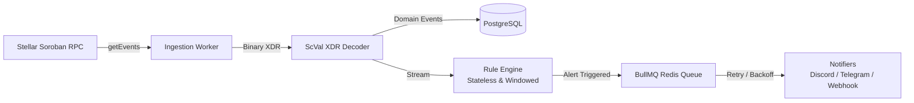

# 🛡️ Soroban Watchdog Backend

> **Enterprise-grade Telemetry, Anomaly Surveillance & Exploit Alerting for Stellar Soroban Smart Contracts.**

[](https://opensource.org/licenses/Apache-2.0)
[](https://stellar.org/soroban)
[](https://www.typescriptlang.org/)
[](https://drips.network)

---

## 📖 Table of Contents
- [Executive Overview](#-executive-overview)
- [Architecture & Data Pipeline](#-architecture--data-pipeline)
- [Repository Structure](#-repository-structure)
- [Architecture Documentation](#-architecture-documentation)
- [Drips Wave Maintainer Roadmap](#-drips-wave-maintainer-roadmap)
- [Local Infrastructure Setup](#-local-infrastructure-setup)
- [Security & Threat Model](#-security--threat-model)

---

## ⚡ Executive Overview

Decentralized applications on Stellar Soroban lack a continuous push-telemetry infrastructure. When a protocol contract experiences abnormal token drain, sudden liquidity manipulation, or emergency pause calls, protocol engineers typically discover the incident only after manual block explorer inspection.

**Soroban Watchdog** bridges this critical infrastructure gap:
1. **Surveillance**: Polls Soroban RPC `getEvents` with cursor management and gap detection.
2. **Decoding**: Converts binary base64 XDR events into strongly typed JavaScript domain models with `BigInt` amount preservation.
3. **Detection Engine**: Evaluates events against modular **Stateless** (value thresholds) and **Windowed** (velocity/frequency surges) detector plugins.
4. **Resilient Alerting**: Employs **BullMQ** on **Redis** for rate-limited, retried dispatches across **Discord**, **Telegram**, and **HMAC-signed Webhooks**.

---

## 📐 Architecture & Data Pipeline



---

## 📂 Repository Structure

```
soroban-watchtower-backend/
├── docs/                        # Complete Architecture & Strategy Blueprints
│   ├── ARCHITECTURE.md          # Full System Architecture & Failure Modes
│   ├── DATABASE_SCHEMA.md       # PostgreSQL ERD & Prisma Models
│   ├── DATA_PIPELINE.md         # Soroban RPC Mechanics & XDR Ingestion
│   ├── API_SPEC.md              # REST API Endpoints & Request/Response Contracts
│   └── DRIPS_WAVE_ROADMAP.md    # 100/150/200 pt Issue Breakdown for Contributors
├── prisma/
│   └── schema.prisma            # Production-grade Database Schema
├── src/
│   ├── config/                  # Environment validation (Zod)
│   ├── server/                  # Fastify REST API Service
│   ├── ingest/                  # Soroban RPC Ingestion Worker
│   ├── decoder/                 # Base64 XDR to ScVal / BigInt Parser
│   ├── detectors/               # Pluggable Rule Detection Engine
│   ├── queue/                   # BullMQ Job Queue Producer & Consumer
│   ├── notifiers/               # Discord, Telegram, Signed Webhook Plugins
│   ├── db/                      # Prisma Client, Repositories & AES Encryption
│   └── types/                   # Shared TypeScript Interfaces & Domain Models
├── tests/                       # Unit, Integration & RPC Mock Tests
├── docker-compose.yml           # Local PostgreSQL & Redis Infrastructure
├── .env.example                 # Environment Configuration Blueprint
└── README.md                    # Project Manifesto & Guide
```

---

## 📚 Architecture Documentation

Detailed architectural specifications are available in the [`docs/`](./docs/) directory:
- [System Architecture Blueprint](./docs/ARCHITECTURE.md)
- [Database Schema & ERD](./docs/DATABASE_SCHEMA.md)
- [Data Pipeline & RPC Ingestion](./docs/DATA_PIPELINE.md)
- [REST API Specification](./docs/API_SPEC.md)
- [Drips Wave Roadmap & Issue Tiers](./docs/DRIPS_WAVE_ROADMAP.md)

---

## 🌊 Drips Wave Maintainer Roadmap

To ensure maximum contributor participation and rapid Wave issue resolution, the codebase exposes clean plugin interfaces:
- **Detector Plugin Interface** (`src/detectors/`): Contributors can build custom detection algorithms (Trivial 100 pts or Medium 150 pts).
- **Notifier Plugin Interface** (`src/notifiers/`): Contributors can add communication channels such as Slack, PagerDuty, or Email (Trivial 100 pts).
- **Core Engine Extensions**: SSRF protection, windowed state aggregation, and RPC batch sharding (Medium 150 pts and High 200 pts).

See [DRIPS_WAVE_ROADMAP.md](./docs/DRIPS_WAVE_ROADMAP.md) for the full 12-issue catalog.

---

## 🛠️ Local Infrastructure Setup

To spin up the local PostgreSQL database and Redis queue:

```bash
# Start PostgreSQL and Redis containers
docker-compose up -d

# Verify services are healthy
docker-compose ps
```

---

## 🔒 Security & Threat Model

- **SSRF Hardening**: Outgoing webhooks are pre-screened to reject loopback (`127.0.0.1`), link-local metadata endpoints (`169.254.169.254`), and private RFC 1918 subnets.
- **Secret Encryption**: Stored webhook destinations and bot tokens are encrypted at rest using AES-256-GCM.
- **BigInt Arithmetic**: Prevents JavaScript floating-point integer overflow during token balance and threshold evaluations.
- **Idempotent Ingestion**: Every event has a unique composite primary key (`ledger-tx-event_index`), guaranteeing zero duplicate alerts.
