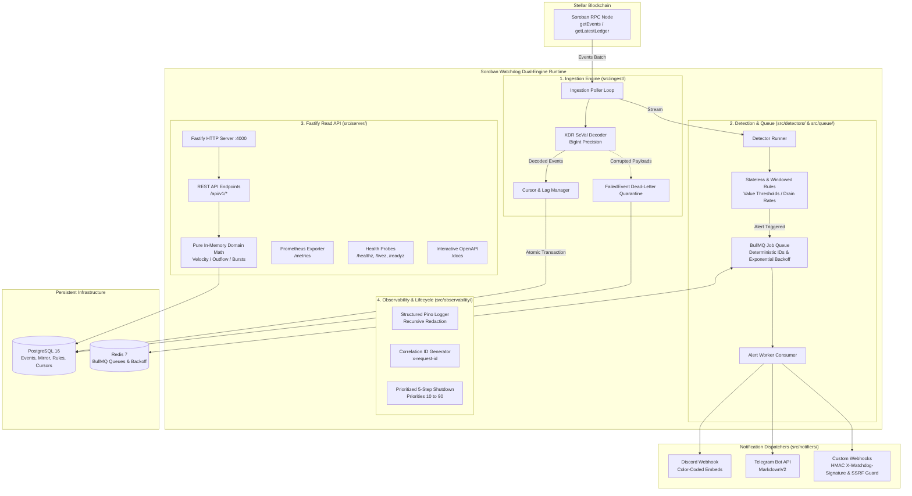
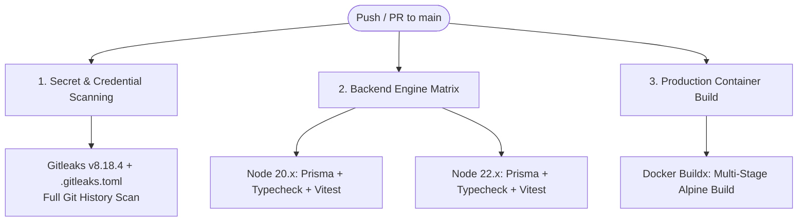

# 🛡️ Soroban Watchdog Backend

> **Enterprise-grade Telemetry, Anomaly Surveillance & Exploit-Alerting Engine for Stellar Soroban Smart Contracts.**

[](https://github.com/Soroban-Watchtower/soroban-watchtower-backend/actions/workflows/ci.yml)
[](LICENSE)
[](https://stellar.org/soroban)
[](https://nodejs.org/)
[](https://www.typescriptlang.org/)
[-729B1B.svg)](https://vitest.dev/)
[](.gitleaks.toml)
[](https://drips.network)

---

## 📖 Table of Contents

- [1. Executive Summary](#1-executive-summary)
- [2. Problem Statement & Architectural Solution](#2-problem-statement--architectural-solution)
- [3. System Architecture & Topology](#3-system-architecture--topology)
- [4. Repository Directory Structure](#4-repository-directory-structure)
- [5. 4-Step Quick Start & Reviewer Guide](#5-4-step-quick-start--reviewer-guide)
- [6. Continuous Integration & Quality Gates (CI/CD)](#6-continuous-integration--quality-gates-cicd)
  - [GitHub Actions Pipeline (`.github/workflows/ci.yml`)](#github-actions-pipeline-githubworkflowsciyml)
  - [Secret Scanning (`.gitleaks.toml`)](#secret-scanning-gitleakstoml)
  - [Pre-Commit Quality Gate (`.pre-commit-config.yaml`)](#pre-commit-quality-gate-pre-commit-configyaml)
- [7. Core Subsystems Deep Dive](#7-core-subsystems-deep-dive)
  - [Idempotent Cursor Management & Lag Bookkeeping](#idempotent-cursor-management--lag-bookkeeping)
  - [Dead-Letter Quarantine & Recovery](#dead-letter-quarantine--recovery)
  - [Zero-Chain-Roundtrip Domain Math](#zero-chain-roundtrip-domain-math)
  - [Ordered Graceful Shutdown Sequence](#ordered-graceful-shutdown-sequence)
- [8. Security & Cryptographic Safeguards](#8-security--cryptographic-safeguards)
- [9. Production Observability & Prometheus Metrics](#9-production-observability--prometheus-metrics)
- [10. REST API Reference & Health Probes](#10-rest-api-reference--health-probes)
- [11. Configuration Reference](#11-configuration-reference)
- [12. Grant, Protocol & Funding Alignment](#12-grant-protocol--funding-alignment)
- [13. Operational Runbooks & Troubleshooting](#13-operational-runbooks--troubleshooting)
- [14. License](#14-license)

---

## 1. Executive Summary

**Soroban Watchdog** is an institutional-grade, push-based surveillance, telemetry, and threat-alerting engine engineered specifically for Stellar Soroban smart contracts. Built as a high-performance dual-engine single-process runtime in strict TypeScript 5.x, Fastify 4.x, PostgreSQL 16 (via Prisma ORM), and Redis 7 (via BullMQ), Soroban Watchdog continuously ingests on-chain events via Soroban RPC, decodes binary XDR payloads into precision 128-bit `BigInt` models, evaluates streaming transactions against pluggable anomaly detectors (stateless value thresholds and sliding-window drain rates), and dispatches cryptographic, SSRF-hardened alerts across Discord, Telegram, and HMAC-signed webhooks with zero upstream RPC roundtrips for external consumers.

---

## 2. Problem Statement & Architectural Solution

| Real-World Pain Point | Consequence in Production | Soroban Watchdog Architectural Solution |
| :--- | :--- | :--- |
| **Latent Exploit Discovery** | Soroban RPC is pull-only; protocol engineers discover exploits or emergency pause triggers hours later via manual explorer checks. | **Push-Based Streaming Surveillance**: Continuous poller queries Soroban RPC `getEvents`, detects critical events in sub-second intervals, and notifies operators immediately. |
| **RPC State Drift & Replay Races** | Network partitions or worker crashes cause missed transactions or double-alerting loops due to uncoordinated cursors. | **Idempotent Cursor Management**: Ledger heights and paging cursors are persisted in interactive PostgreSQL transactions (`IngestionState`) with strictly forward-moving cursor progression. |
| **Unparseable XDR & Poller Crashes** | A single contract emitting unexpected XDR structures or malformed topics crashes typical daemon loops, halting ingestion. | **Dead-Letter Quarantine (`FailedEvent`)**: Malformed payloads are intercepted, quarantined with stack traces, and operator CLI tools (`replay-failed-events`, `prune-failed-events`) allow live recovery. |
| **External Read Latency & Rate Limits** | Querying on-chain RPC nodes for historical telemetry exhausts RPC quotas and introduces high latency (200ms–2000ms). | **Zero-Chain-Roundtrip Domain Math**: Telemetry queries are computed entirely in-memory from a local PostgreSQL mirror using pure domain math (`src/lib/domainMath.ts`) in sub-milliseconds. |
| **Insecure Outgoing Webhooks** | Automated webhook dispatches are susceptible to Server-Side Request Forgery (SSRF) and tampering in transit. | **Cryptographic Security Layer**: Outgoing webhooks enforce asynchronous DNS validation to block private/cloud-metadata subnets and include HMAC-SHA256 request signatures. |

---

## 3. System Architecture & Topology

The runtime operates a dual-engine architecture coordinated within a single Node.js process: an **Ingestion & Detection Engine** running background polling and BullMQ dispatch, and a **Fastify Read API** serving zero-latency telemetry queries, OpenAPI documentation, and Kubernetes health probes.



---

## 4. Repository Directory Structure

```text
soroban-watchtower-backend/
├── .github/
│   ├── workflows/
│   │   └── ci.yml                # Multi-job CI pipeline (Gitleaks, Node 20/22, Docker)
│   └── FUNDING.yml               # GitHub Sponsors and community funding configuration
├── .gitleaks.toml                # Custom secret scanning rules & Stellar allowlists
├── .pre-commit-config.yaml       # Pre-commit security, hygiene & typecheck gates
├── .editorconfig                 # Standardized file formatting across environments
├── .env.example                  # Validated environment configuration template
├── .gitignore                    # Version control ignore rules
├── Dockerfile                    # Production multi-stage, non-root Alpine container build
├── docker-compose.yml            # PostgreSQL 16 + Redis 7 + Watchdog orchestration
├── FUNDING.json                  # Drips Wave & Stellar Community Fund metadata
├── LICENSE                       # Apache 2.0 Open Source License
├── package.json                  # Scripts, production dependencies, and engine requirements
├── tsconfig.json                 # Strict TypeScript 5.x configuration
├── vitest.config.ts              # Vitest test framework configuration
├── prisma/
│   ├── schema.prisma             # PostgreSQL schema with composite indexes & enums
│   └── migrations/               # Version-controlled SQL migration history
├── docs/                         # Engineering & operational runbook documentation
│   ├── README.md                 # Complete documentation navigation index
│   ├── ARCHITECTURE.md           # Subsystem architecture, topology & failure resilience
│   ├── API_SPEC.md               # REST API payload contracts & problem details
│   ├── DATABASE_SCHEMA.md        # Comprehensive PostgreSQL field reference
│   ├── DATA_PIPELINE.md          # Event ingestion to notification dispatch lifecycle
│   ├── DRIPS_WAVE_ROADMAP.md     # Contributor issue catalog & maintainer checklist
│   ├── database-schema.md        # Detailed relational model and indexing strategy
│   ├── failure-modes.md          # Failure matrix, circuit breakers & recovery runbooks
│   ├── poll-tick-sequence.md     # Ingestion poller tick sequence diagram
│   ├── request-lifecycle.md      # HTTP request lifecycle & zero-roundtrip telemetry
│   ├── shutdown-ordering.md      # 5-step prioritized graceful termination sequence
│   └── glossary.md               # Soroban, XDR & distributed systems domain terminology
├── src/
│   ├── index.ts                  # Unified dual-engine single-process bootstrap
│   ├── simulate.ts               # End-to-End Simulation & Live Testnet verification script
│   ├── config/                   # Zod environment validation (`env.ts`)
│   ├── db/                       # Prisma client singleton & AES-256-GCM encryption
│   ├── decoder/                  # Binary XDR ScVal parser & BigInt safe arithmetic
│   ├── detectors/                # Pluggable detector rules (Stateless & Windowed)
│   │   ├── detectorRunner.ts     # Multi-rule evaluator & alert dispatcher
│   │   ├── stateless/            # Single-event threshold & pause detectors
│   │   └── windowed/             # Rolling window drain-rate & failure detectors
│   ├── ingest/                   # Poller loop, cursor manager, and recovery tools
│   │   ├── poller.ts             # Ingestion poller with backlog fast-forwarding
│   │   ├── cursorManager.ts      # Atomic cursor persistence & real-time lag bookkeeping
│   │   ├── failedEventManager.ts # Dead-letter quarantine storage
│   │   ├── replay.ts             # CLI tool to replay quarantined events
│   │   └── prune.ts              # CLI tool to prune resolved dead-letter records
│   ├── lib/
│   │   └── domainMath.ts         # Pure domain math for zero-chain-roundtrip queries
│   ├── notifiers/                # Notification channel dispatchers & network guards
│   │   ├── ssrfValidator.ts      # SSRF defense with asynchronous DNS validation
│   │   ├── webhook.ts            # Custom webhook dispatcher with HMAC signatures
│   │   ├── discord.ts            # Discord webhook with color-coded severity embeds
│   │   ├── telegram.ts           # Telegram Bot API dispatcher
│   │   └── verifyDispatch.ts     # Interactive CLI tool for live alert verification
│   ├── observability/            # Production observability & process lifecycle
│   │   ├── metrics.ts            # Prometheus metrics registry (counters, gauges, histograms)
│   │   ├── errorRedaction.ts     # Deep recursive credential and token sanitizer
│   │   ├── requestId.ts          # Correlation ID generator & Fastify plugin
│   │   ├── logger.ts             # Structured Pino logger with redaction hooks
│   │   └── shutdown.ts           # Prioritized 5-step graceful shutdown manager
│   ├── queue/                    # BullMQ job producer and retry consumer
│   │   ├── alertQueue.ts         # BullMQ queue producer with deterministic job IDs
│   │   └── alertWorker.ts        # BullMQ worker consumer with exponential backoff
│   ├── server/                   # Fastify HTTP service, Swagger UI, and routes
│   │   ├── server.ts             # Fastify setup, plugins, and route registration
│   │   ├── errorHandlers.ts      # RFC 7807 problem details error formatter
│   │   ├── healthRoutes.ts       # Multi-tier health probes (/healthz, /livez, /readyz)
│   │   └── routes/               # API v1 routes (contracts, rules, telemetry, alerts)
│   └── types/                    # Shared TypeScript domain interfaces
└── tests/
    └── unit/                     # Comprehensive test suites (164 tests, 18 suites)
```

---

## 5. 4-Step Quick Start & Reviewer Guide

Follow these 4 steps to install, test, start, and verify the entire system locally:

### Step 1: Install & Prerequisites
Ensure you have **Node.js >= 20.12.0** and **Docker** installed.
```bash
# 1. Clone repository
git clone https://github.com/Soroban-Watchtower/soroban-watchtower-backend.git
cd soroban-watchtower-backend

# 2. Copy environment template
cp .env.example .env

# 3. Install dependencies
npm install
```

### Step 2: Test & Static Validation
Verify codebase integrity using TypeScript strict typechecking and the 164-test Vitest suite:
```bash
# Run strict TypeScript typecheck (tsc --noEmit)
npm run typecheck

# Execute all 18 unit and integration test suites (164 passing tests)
npm test

# Run tests with code coverage analysis
npm run test:coverage
```

### Step 3: Local Infrastructure via Docker
Spin up PostgreSQL 16 and Redis 7, then generate the Prisma client and apply database migrations:
```bash
# Start PostgreSQL and Redis containers in the background
docker compose up -d postgres redis

# Generate Prisma client and apply migrations
npm run prisma:generate
npm run prisma:migrate
```

### Step 4: Run Dual-Engine & Live Simulation
Launch the unified service and run the end-to-end simulation against live Soroban Testnet RPC:
```bash
# Start unified dual-engine runtime (Fastify API + Poller + Queue Worker)
npm run dev

# In a separate terminal: execute End-to-End Simulation against Stellar Testnet
npm run simulate

# (Optional) Test live alert dispatch to a Discord channel or Webhook.site
npm run simulate -- --webhook="https://discord.com/api/webhooks/<channel-id>/<token>"
```

---

## 6. Continuous Integration & Quality Gates (CI/CD)

The repository implements a defense-in-depth quality and security strategy spanning both GitHub Actions CI and local developer pre-commit hooks:



### GitHub Actions Pipeline (`.github/workflows/ci.yml`)
The workflow triggers on all pushes to `main`, `feature/*`, and `feat/*`, as well as on pull requests targeting `main`. It runs 3 parallel jobs:

1. **`security-audit`**:
   - Executes with `fetch-depth: 0` to scan the complete repository git history.
   - Installs and runs **Gitleaks v8.18.4** (`gitleaks detect --config=.gitleaks.toml --verbose --redact`).
   - Fails immediately if unencrypted private keys, tokens, or credentials are discovered.
2. **`backend-api`**:
   - Matrix testing across **Node.js 20.x** and **Node.js 22.x**.
   - Generates Prisma client with dummy connection credentials.
   - Executes strict static typecheck (`npm run typecheck`).
   - Executes 164 Vitest tests covering all subsystems (`npm test`).
   - Executes production TypeScript compilation (`npm run build`).
3. **`container-build`**:
   - Sets up Docker Buildx and builds the multi-stage production Docker image (`docker build -t soroban-watchtower-backend:ci .`).
   - Validates that non-root container packaging builds cleanly without missing runtime dependencies.

### Secret Scanning (`.gitleaks.toml`)
Custom allowlists prevent false positives while strictly protecting repository integrity:
- **Stellar Public Addresses**: Allows public account keys matching `^G[A-Z0-9]{55}$`.
- **Soroban Contract Addresses**: Allows contract addresses matching `^C[A-Z0-9]{55}$`.
- **Benign Test Fixtures**: Allowlists mock hex encryption keys in `tests/`, `.env.example`, and documentation guides.

### Pre-Commit Quality Gate (`.pre-commit-config.yaml`)
Enforces formatting, file size limits, secret detection, and strict typechecking before commits reach version control:
```bash
# Install pre-commit (if using Python / pip)
pip install pre-commit
pre-commit install

# Run checks manually across all files
pre-commit run --all-files
```
- **Hygiene**: Strips trailing whitespace, standardizes LF line endings, validates JSON and YAML formatting.
- **File Size Guard**: Rejects large binary commits (`--maxkb=500`).
- **Local Secret Scanning**: Runs Gitleaks against staged files.
- **Local Typecheck**: Runs `npm run typecheck` automatically when TypeScript files are staged.

---

## 7. Core Subsystems Deep Dive

### Idempotent Cursor Management & Lag Bookkeeping
The Ingestion Poller (`src/ingest/poller.ts`) and Cursor Manager (`src/ingest/cursorManager.ts`) guarantee strictly forward-moving ingestion without duplicate events:
- **Cursor Tracking**: Soroban RPC pagination cursors (`{ledger}-{txIndex}-{eventIndex}`) are updated atomically with decoded events in an interactive PostgreSQL transaction (`db.$transaction`).
- **Real-Time Lag Metric**:
  $$\text{Poller Lag (Ledgers)} = \max\Big(0, \text{chainLedger} - \text{lastLedgerSequence}\Big)$$
  Lag is emitted continuously to Prometheus (`soroban_poller_lag_ledgers`) and checked on the `/readyz` probe.
- **Backlog Fast-Forwarding**: If the service recovers from downtime, the poller loops without sleeping until lag reaches 0, fast-forwarding through historical ledgers.

### Dead-Letter Quarantine & Recovery
If upstream contracts emit malformed or unparseable binary XDR:
1. `FailedEventManager` quarantines the raw payload, contract ID, and error stack trace in the `FailedEvent` table with status `PENDING`.
2. The poller logs the quarantine event at `WARN` level and advances the cursor, preventing ingestion deadlocks.
3. Operators inspect and replay or prune quarantined records using dedicated CLI commands:
   ```bash
   # Replay pending quarantined events through the decoder
   npm run replay-failed-events

   # Prune resolved events older than 14 days
   npm run prune-failed-events -- --days=14
   ```

### Zero-Chain-Roundtrip Domain Math
External consumers querying contract telemetry (`GET /api/v1/telemetry/:contractId`) never query the upstream blockchain RPC:
- All historical events are retrieved from the local PostgreSQL mirror.
- In-memory domain math (`src/lib/domainMath.ts`) calculates transfer velocities, rolling percentiles, capital outflow ratios, and burst rates on the fly in sub-milliseconds.
- Protects downstream services from Soroban RPC rate-limiting (HTTP 429) and network latency spikes.

### Ordered Graceful Shutdown Sequence
When receiving `SIGINT` or `SIGTERM`, `GracefulShutdownManager` (`src/observability/shutdown.ts`) executes a prioritized 5-step teardown:
1. **Priority 10**: Halt Ingestion Poller (stop pulling new events from Soroban RPC).
2. **Priority 20**: Drain Alert Queue Worker (allow active BullMQ jobs and webhook deliveries to finish).
3. **Priority 30**: Close Fastify HTTP Server (stop accepting new TCP connections; finish in-flight requests).
4. **Priority 40**: Drain Database Pool & Disconnect Redis (flush pending queries cleanly).
5. **Exit 0**: Clean process exit within a strict 15-second timeout window.

---

## 8. Security & Cryptographic Safeguards

1. **SSRF Guard (`src/notifiers/ssrfValidator.ts`)**:
   - Intercepts all outgoing webhook dispatch requests.
   - Enforces `https://` protocol.
   - Performs asynchronous DNS lookup to validate resolved IP addresses.
   - Blocks private, loopback, and cloud metadata subnets:
     `127.0.0.0/8`, `10.0.0.0/8`, `172.16.0.0/12`, `192.168.0.0/16`, `169.254.0.0/16` (AWS/GCP/Azure Metadata), `fc00::/7` (IPv6 ULA), and `fe80::/10` (Link-Local).
2. **HMAC-SHA256 Cryptographic Request Signing**:
   - Custom webhooks calculate an HMAC-SHA256 digest over `{ timestamp, payload }` using the channel's shared secret.
   - Dispatches with header `X-Watchdog-Signature: sha256=<hex>`.
   - Verified on receiving servers using timing-safe comparisons (`crypto.timingSafeEqual`).
3. **AES-256-GCM Secret Encryption at Rest**:
   - Channel destination URLs and sensitive bot tokens are encrypted in PostgreSQL using AES-256-GCM with unique 96-bit initialization vectors (IV) and 128-bit authentication tags.
4. **Deep Recursive Redaction**:
   - Structured Pino logger (`src/observability/errorRedaction.ts`) scrubs Bearer tokens, private keys, database URLs, and passwords from logs and error traces before stdout serialization.

---

## 9. Production Observability & Prometheus Metrics

Metrics are exported in Prometheus text exposition format on `GET /metrics`:

| Metric Name | Type | Labels | Description |
| :--- | :--- | :--- | :--- |
| `soroban_poller_lag_ledgers` | Gauge | `contract_id` | Real-time poller lag in ledgers (`chainLedger - lastLedger`). |
| `soroban_poller_chain_ledger` | Gauge | `network` | Upstream Soroban blockchain head ledger sequence. |
| `soroban_poller_last_ledger` | Gauge | `contract_id` | Last ledger sequence successfully processed and persisted. |
| `soroban_poller_ticks_total` | Counter | `status` | Total poller tick executions (`success`, `empty`, `error`). |
| `soroban_poller_tick_duration_seconds` | Histogram | - | Duration of poller ingestion tick in seconds. |
| `soroban_events_ingested_total` | Counter | `contract_id`, `event_type` | Total decoded events ingested from the blockchain. |
| `soroban_failed_events_total` | Counter | `contract_id`, `reason` | Total unparseable events quarantined in dead-letter table. |
| `soroban_alerts_triggered_total` | Counter | `rule_id`, `severity` | Total anomaly alerts generated by detector runner. |
| `soroban_alert_deliveries_total` | Counter | `channel_type`, `status` | Total notification dispatches to Discord, Telegram, or Webhook. |
| `soroban_http_requests_total` | Counter | `method`, `route`, `status_code` | Total incoming HTTP requests handled by REST API. |
| `soroban_http_request_duration_seconds` | Histogram | `method`, `route` | Latency distribution of REST API request handling. |

### Recommended Prometheus Alerting Rules
```yaml
groups:
  - name: soroban_watchdog_alerts
    rules:
      - alert: SorobanPollerLagCritical
        expr: soroban_poller_lag_ledgers > 30
        for: 2m
        labels:
          severity: critical
        annotations:
          summary: "Soroban Watchdog is falling behind on contract {{ $labels.contract_id }}"

      - alert: SorobanDeadLetterSpike
        expr: rate(soroban_failed_events_total[5m]) > 0.1
        for: 1m
        labels:
          severity: warning
        annotations:
          summary: "Unparseable Soroban events quarantined in dead-letter storage"
```

---

## 10. REST API Reference & Health Probes

Interactive OpenAPI/Swagger documentation is hosted at `http://localhost:4000/docs`. All errors conform to **RFC 7807 Problem Details** (`application/problem+json`).

### Health & Observability Endpoints
| Method | Endpoint | Description |
| :--- | :--- | :--- |
| `GET` | `/healthz` | Basic process liveness probe (`{ status: "ok", uptime: ... }`). |
| `GET` | `/livez` | Kubernetes liveness probe with process memory and V8 heap statistics. |
| `GET` | `/readyz` | Kubernetes readiness probe (checks PostgreSQL connectivity and poller lag threshold). |
| `GET` | `/metrics` | Prometheus metrics text exposition endpoint. |

### Core Telemetry & Anomaly Endpoints
| Method | Endpoint | Description |
| :--- | :--- | :--- |
| `GET` | `/api/v1/contracts` | List all monitored contracts with cursor state, lag, and event counts. |
| `POST` | `/api/v1/contracts` | Register a new Soroban contract (`C...`) for automated surveillance. |
| `GET` | `/api/v1/contracts/:id` | Get contract details with real-time lag analysis. |
| `PATCH` | `/api/v1/contracts/:id` | Update contract name or toggle active monitoring state. |
| `DELETE` | `/api/v1/contracts/:id` | Deregister contract from surveillance. |
| `GET` | `/api/v1/rules` | List all configured anomaly detection rules. |
| `POST` | `/api/v1/rules` | Create a detector rule with custom thresholds and parameters. |
| `PATCH` | `/api/v1/rules/:id` | Modify parameters or toggle detector rule status. |
| `DELETE` | `/api/v1/rules/:id` | Remove detector rule. |
| `GET` | `/api/v1/channels` | List notification channels (destinations masked, secrets omitted). |
| `POST` | `/api/v1/channels` | Register notification channel (encrypted at rest using AES-256-GCM). |
| `DELETE` | `/api/v1/channels/:id` | Delete notification channel. |
| `GET` | `/api/v1/alerts` | Paginated query of triggered alerts with filters (`severity`, `ruleId`, `contractId`). |
| `GET` | `/api/v1/alerts/:id` | Retrieve single alert detail with channel dispatch logs. |
| `GET` | `/api/v1/telemetry/:contractId` | **Zero-Chain-Roundtrip** in-memory telemetry, velocity, and frequency summary. |
| `GET` | `/api/v1/failed-events` | Query dead-letter quarantined events. |
| `POST` | `/api/v1/failed-events/:id/replay` | Manually re-evaluate and replay a single failed event. |
| `POST` | `/api/v1/failed-events/:id/discard` | Mark a failed event as discarded. |

---

## 11. Configuration Reference

All settings are validated at boot time via **Zod** (`src/config/env.ts`):

| Variable | Type | Default | Required | Description |
| :--- | :--- | :--- | :--- | :--- |
| `NODE_ENV` | String | `development` | No | Runtime environment (`development`, `production`, `test`). |
| `PORT` | Number | `4000` | No | Fastify HTTP port listener. |
| `DATABASE_URL` | String | - | **Yes** | PostgreSQL connection string (`postgresql://...`). |
| `REDIS_URL` | String | - | **Yes** | Redis connection URL for BullMQ queue. |
| `SOROBAN_RPC_URL` | String | - | **Yes** | Stellar Soroban RPC node endpoint. |
| `ENCRYPTION_KEY` | Hex (64 chars) | - | **Yes** | 32-byte hexadecimal key for AES-256-GCM encryption. |
| `POLL_INTERVAL_MS` | Number | `5000` | No | Milliseconds between poller loop iterations. |
| `MAX_EVENTS_PER_BATCH` | Number | `100` | No | Maximum event limit requested per RPC batch. |
| `MONITOR_CONTRACT_ID` | String | `CDLZFC...` | No | Default Soroban contract monitored on cold start. |
| `LOG_LEVEL` | String | `info` | No | Pino logging level (`debug`, `info`, `warn`, `error`). |

---

## 12. Grant, Protocol & Funding Alignment

Soroban Watchdog is designed as critical public-good infrastructure for the Stellar Soroban ecosystem.

- **Drips Wave Approved**: The repository adheres strictly to Drips Wave maintainer standards. See [`docs/DRIPS_WAVE_ROADMAP.md`](./docs/DRIPS_WAVE_ROADMAP.md) for the maintainer checklist and tiered contributor issue catalog (Trivial, Medium, and High complexity tasks).
- **Stellar Community Fund (SCF)**: Application track under Developer Tooling & Infrastructure.
- **Grant Metadata Specification**: See [`FUNDING.json`](./FUNDING.json) and [`.github/FUNDING.yml`](./.github/FUNDING.yml) for protocol funding alignment, maintainer identities, and links.
- **Issue Backlog**: Check the GitHub issue tracker for open tasks eligible for community contributions.

---

## 13. Operational Runbooks & Troubleshooting

### Q: Why is `soroban_poller_lag_ledgers` increasing?
1. Inspect the poller logs (`npm run dev:ingest` or check container logs).
2. Verify that the Soroban RPC node (`SOROBAN_RPC_URL`) is responding and not returning HTTP 429.
3. If the watchdog was offline for a prolonged period, the backlog fast-forwarding mechanism will automatically catch up without sleeping between batches until `lag = 0`.

### Q: How do I recover events from the dead-letter quarantine table?
If malformed events were quarantined in `FailedEvent`:
```bash
# Inspect pending items via API
curl http://localhost:4000/api/v1/failed-events?status=PENDING

# Replay all pending quarantined events
npm run replay-failed-events
```

### Q: How do I test an alert dispatch to a live Discord channel or Webhook.site?
```bash
# Send test alert to a live Webhook.site URL
npx tsx src/notifiers/verifyDispatch.ts --url https://webhook.site/<your-uuid> --secret my-secret

# Send test alert to a live Discord channel
npx tsx src/notifiers/verifyDispatch.ts --url https://discord.com/api/webhooks/<channel-id>/<token>
```

---

## 14. License

Licensed under the Apache License, Version 2.0 (the "License"). See [LICENSE](./LICENSE) for details.
