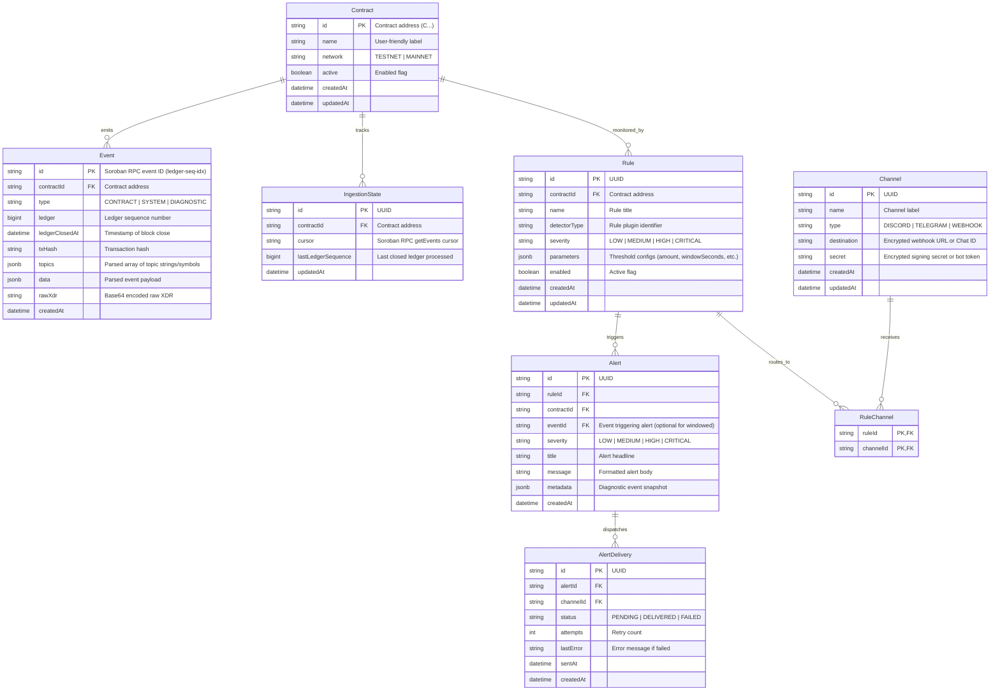

# 🗄️ Database Architecture & Data Models

The persistence layer is designed for high-throughput time-series event ingestion, idempotency, and query efficiency.

---

## 1. Entity Relationship Diagram (ERD)



---

## 2. Prisma Schema Specification

```prisma
datasource db {
  provider = "postgresql"
  url      = env("DATABASE_URL")
}

generator client {
  provider = "prisma-client-js"
}

enum Network {
  TESTNET
  MAINNET
}

enum Severity {
  LOW
  MEDIUM
  HIGH
  CRITICAL
}

enum ChannelType {
  DISCORD
  TELEGRAM
  WEBHOOK
}

enum DeliveryStatus {
  PENDING
  DELIVERED
  FAILED
}

model Contract {
  id              String           @id // Soroban Contract Address 'C...'
  name            String
  network         Network          @default(TESTNET)
  active          Boolean          @default(true)
  createdAt       DateTime         @default(now())
  updatedAt       DateTime         @updatedAt

  events          Event[]
  ingestionStates IngestionState[]
  rules           Rule[]
  alerts          Alert[]

  @@index([network, active])
}

model IngestionState {
  id                 String   @id @default(uuid())
  contractId         String   @unique
  cursor             String?  // RPC pagination cursor
  lastLedgerSequence BigInt   @default(0)
  updatedAt          DateTime @updatedAt

  contract           Contract @relation(fields: [contractId], references: [id], onDelete: Cascade)
}

model Event {
  id             String   @id // Formatted as '{ledgerSequence}-{transactionIndex}-{eventIndex}'
  contractId     String
  type           String   // contract, system, or diagnostic
  ledger         BigInt
  ledgerClosedAt DateTime
  txHash         String
  topics         Json     // Array of decoded strings/values
  data           Json     // Decoded event payload
  rawXdr         String   @db.Text
  createdAt      DateTime @default(now())

  contract       Contract @relation(fields: [contractId], references: [id], onDelete: Cascade)
  alerts         Alert[]

  @@index([contractId, ledgerClosedAt(sort: Desc)])
  @@index([contractId, ledger(sort: Desc)])
  @@index([txHash])
}

model Rule {
  id           String        @id @default(uuid())
  contractId   String
  name         String
  detectorType String        // e.g., 'LARGE_TRANSFER', 'RAPID_DRAIN', 'PAUSE_TRIGGERED'
  severity     Severity      @default(MEDIUM)
  parameters   Json          // { "threshold": "10000000000", "windowMinutes": 5 }
  enabled      Boolean       @default(true)
  createdAt    DateTime      @default(now())
  updatedAt    DateTime      @updatedAt

  contract     Contract      @relation(fields: [contractId], references: [id], onDelete: Cascade)
  channels     RuleChannel[]
  alerts       Alert[]

  @@index([contractId, enabled])
}

model Channel {
  id          String        @id @default(uuid())
  name        String
  type        ChannelType
  destination String        // AES-256 encrypted URL or chat ID
  secret      String?       // AES-256 encrypted HMAC signing secret or token
  createdAt   DateTime      @default(now())
  updatedAt   DateTime      @updatedAt

  rules       RuleChannel[]
  deliveries  AlertDelivery[]
}

model RuleChannel {
  ruleId    String
  channelId String

  rule      Rule    @relation(fields: [ruleId], references: [id], onDelete: Cascade)
  channel   Channel @relation(fields: [channelId], references: [id], onDelete: Cascade)

  @@id([ruleId, channelId])
}

model Alert {
  id         String          @id @default(uuid())
  ruleId     String
  contractId String
  eventId    String?
  severity   Severity
  title      String
  message    String          @db.Text
  metadata   Json
  createdAt  DateTime        @default(now())

  rule       Rule            @relation(fields: [ruleId], references: [id], onDelete: Cascade)
  contract   Contract        @relation(fields: [contractId], references: [id], onDelete: Cascade)
  event      Event?          @relation(fields: [eventId], references: [id], onDelete: SetNull)
  deliveries AlertDelivery[]

  @@index([contractId, createdAt(sort: Desc)])
  @@index([ruleId])
}

model AlertDelivery {
  id        String         @id @default(uuid())
  alertId   String
  channelId String
  status    DeliveryStatus @default(PENDING)
  attempts  Int            @default(0)
  lastError String?        @db.Text
  sentAt    DateTime?
  createdAt DateTime       @default(now())

  alert     Alert          @relation(fields: [alertId], references: [id], onDelete: Cascade)
  channel   Channel        @relation(fields: [channelId], references: [id], onDelete: Cascade)

  @@index([status, createdAt])
}
```

---

## 3. Indexing & Optimization Strategy
- **Time-Series Queries**: `@@index([contractId, ledgerClosedAt(sort: Desc)])` guarantees instant retrieval of recent contract activity for charting and anomaly detection.
- **Deduplication / Idempotency**: `Event.id` mirrors the Soroban RPC event unique identifier (`ledger-tx_idx-event_idx`). Duplicate inserts are ignored using database-level `ON CONFLICT DO NOTHING`.
- **Encryption at Rest**: `Channel.destination` and `Channel.secret` are encrypted using AES-256-GCM before write and decrypted only in memory within the notifier worker.
