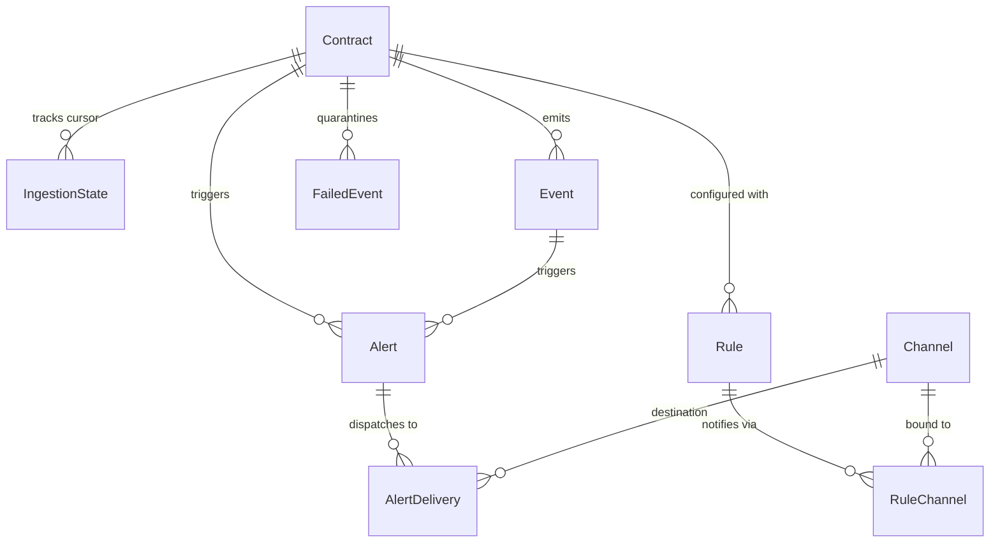

# 🗄️ Database Schema & Storage Architecture

This document provides a field-by-field reference for the PostgreSQL relational schema utilized by **Soroban Watchdog**, detailing index rationale, data integrity constraints, and cryptographic safeguards.

---

## 1. Schema Diagram & Relationships

---

## 2. Model Specifications

### A. `Contract`
Tracks monitored Soroban smart contract addresses.

| Field | Type | Attributes | Description |
| :--- | :--- | :--- | :--- |
| `id` | `String` | `@id` | Primary key representing the 56-character Soroban contract address (`C...`). |
| `name` | `String` | | Human-readable alias (e.g., `"USDC Token"`, `"Soroswap Router"`). |
| `network` | `Network` | `@default(TESTNET)` | Network environment (`TESTNET` or `MAINNET`). |
| `active` | `Boolean` | `@default(true)` | Whether the background poller actively monitors this contract. |
| `createdAt` | `DateTime` | `@default(now())` | Registration timestamp. |
| `updatedAt` | `DateTime` | `@updatedAt` | Last modification timestamp. |

- **Indexes**:
  - `@@index([network, active])`: Optimizes poller query `SELECT * FROM Contract WHERE network = 'TESTNET' AND active = true`.

---

### B. `IngestionState`
Maintains cursor and ledger lag bookmarks. Strictly one row per contract.

| Field | Type | Attributes | Description |
| :--- | :--- | :--- | :--- |
| `id` | `String` | `@id @default(uuid())` | Surrogate primary key. |
| `contractId` | `String` | `@unique` | Foreign key referencing `Contract.id`. Enforces 1-to-1 relationship. |
| `cursor` | `String?` | | Opaque RPC pagination cursor returned by Soroban `getEvents`. |
| `lastLedgerSequence` | `BigInt` | `@default(0)` | Highest ledger sequence fully processed and persisted by watchdog. |
| `chainLedger` | `BigInt` | `@default(0)` | Latest ledger sequence on upstream blockchain reported by RPC node. |
| `lastEventId` | `String?` | | Unique event ID (`{ledger}-{txIndex}-{eventIndex}`) processed last. |
| `updatedAt` | `DateTime` | `@updatedAt` | Timestamp of last cursor advancement. |

- **Lag Calculation**:
  $$\text{Poller Lag} = \max(0, \text{chainLedger} - \text{lastLedgerSequence})$$

---

### C. `Event`
Persists decoded Soroban smart contract events.

| Field | Type | Attributes | Description |
| :--- | :--- | :--- | :--- |
| `id` | `String` | `@id` | Natural primary key formatted as `{ledger}-{txIndex}-{eventIndex}`. |
| `contractId` | `String` | | Foreign key referencing `Contract.id`. |
| `type` | `String` | | Event classification (`contract`, `system`, or `diagnostic`). |
| `ledger` | `BigInt` | | Stellar ledger sequence where event occurred. |
| `ledgerClosedAt` | `DateTime` | | Precise ledger close timestamp. |
| `txHash` | `String` | | 64-character transaction hash hex string. |
| `topics` | `Json` | | Array of decoded event topic values (strings, symbols, BigInt amounts). |
| `data` | `Json` | | Decoded event value or map structure. |
| `rawXdr` | `String` | `@db.Text` | Unaltered base64-encoded Stellar XDR payload for auditing. |
| `createdAt` | `DateTime` | `@default(now())` | Ingestion timestamp. |

- **Indexes**:
  - `@@index([contractId, ledgerClosedAt(sort: Desc)])`: Accelerates sliding time-window detector queries.
  - `@@index([contractId, ledger(sort: Desc)])`: Optimizes ledger height queries and pagination.
  - `@@index([txHash])`: Fast lookup of all events emitted within a given transaction.

---

### D. `FailedEvent` (Dead-Letter Quarantine)
Stores unparseable or rejected raw payloads for inspection and recovery.

| Field | Type | Attributes | Description |
| :--- | :--- | :--- | :--- |
| `id` | `String` | `@id @default(uuid())` | Quarantine entry ID. |
| `contractId` | `String` | | Target contract address. |
| `eventId` | `String?` | | Extracted raw event ID if available. |
| `eventType` | `String?` | | Raw event type. |
| `rawPayload` | `Json` | | Raw unparseable JSON payload from RPC. |
| `errorLog` | `String` | `@db.Text` | Detailed error message and stack trace. |
| `retryCount` | `Int` | `@default(0)` | Number of times replay was attempted. |
| `status` | `FailedEventStatus` | `@default(PENDING)` | Current status (`PENDING`, `RESOLVED`, `DISCARDED`). |
| `createdAt` | `DateTime` | `@default(now())` | Quarantine timestamp. |
| `updatedAt` | `DateTime` | `@updatedAt` | Last modification timestamp. |

- **Indexes**:
  - `@@index([contractId, status])`: Fast retrieval of pending failed events per contract.
  - `@@index([status, createdAt])`: Efficient batching for CLI replay and pruning tools.

---

### E. `Channel`
Destination endpoints for alert delivery.

| Field | Type | Attributes | Description |
| :--- | :--- | :--- | :--- |
| `id` | `String` | `@id @default(uuid())` | Channel ID. |
| `name` | `String` | | User-friendly channel alias. |
| `type` | `ChannelType` | | Destination protocol (`DISCORD`, `TELEGRAM`, `WEBHOOK`). |
| `destination` | `String` | | **AES-256-GCM Encrypted** URL or Telegram chat ID. |
| `secret` | `String?` | | **AES-256-GCM Encrypted** signing secret or bot token. |
| `createdAt` | `DateTime` | `@default(now())` | Creation timestamp. |
| `updatedAt` | `DateTime` | `@updatedAt` | Modification timestamp. |

---

## 3. Cryptographic Storage Standards

All webhook destinations and signing secrets are encrypted at rest using **AES-256-GCM**:
- **Key**: 256-bit (32 bytes) resolved from `ENCRYPTION_KEY`.
- **Initialization Vector (IV)**: 96-bit (12 bytes) cryptographically randomized per encryption call via `crypto.randomBytes(12)`.
- **Authentication Tag**: 128-bit (16 bytes) verifying payload integrity against tampering.
- **Storage Format**: `ivHex:authTagHex:ciphertextHex`.
