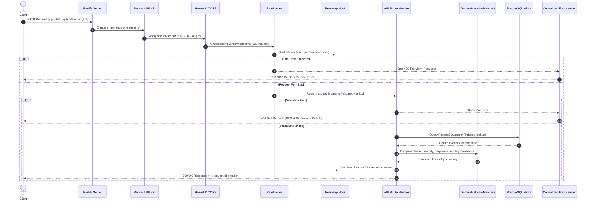

# 🌐 Request Lifecycle Architecture

This document maps the complete journey of an incoming HTTP request through **Soroban Watchdog's Fastify Read API**, detailing security middleware, telemetry hooks, and zero-chain-roundtrip execution.

---

## 1. Request Flow Diagram

---

## 2. Step-by-Step Lifecycle Phases

### Phase 1: Ingress & Correlation ID (`src/observability/requestId.ts`)
1. Fastify inspects the incoming request for the `x-request-id` header.
2. If absent or empty, the server generates a collision-resistant UUID v4 prefixed with `req_` (e.g., `req_9b8f7e6d5c4b3a210fedcba987654321`).
3. The ID is bound to `request.requestId` and injected into the outgoing response headers.
4. All structured Pino logs generated during the request inherit this correlation ID.

### Phase 2: Security & Rate Limiting (`src/server/server.ts`)
1. **CORS**: Evaluates permitted origins, credentials, and allowed HTTP methods.
2. **Helmet**: Injects security headers (`X-Content-Type-Options: nosniff`, `X-Frame-Options: SAMEORIGIN`, `Strict-Transport-Security`).
3. **Rate Limiting**: Employs an in-memory sliding window rate limiter (200 requests per minute per IP address).

### Phase 3: Route Matching & Schema Validation (`src/server/routes/`)
1. Parameters and JSON request bodies are validated against strict **Zod** schemas.
2. If invalid, the request terminates immediately with an **RFC 7807 Problem Details** JSON payload detailing exact field paths and failure reasons.

### Phase 4: Zero-Chain-Roundtrip Execution (`src/lib/domainMath.ts`)
1. **The Read API never makes network calls to external blockchain RPC nodes**.
2. All contract telemetry, historical events, and cursor markers are retrieved from the local PostgreSQL mirror.
3. Derived analytical indicators (transfer velocity, event frequency, burst detection, and poller lag) are computed in-memory using pure domain math.
4. Guarantees consistent sub-millisecond response latency.

### Phase 5: Metrics & Egress Telemetry (`src/observability/metrics.ts`)
1. On request completion, the `onResponse` hook calculates total request duration.
2. Increments Prometheus counter `soroban_http_requests_total` with labels `{ method, route, status_code }`.
3. Observes execution latency in histogram `soroban_http_request_duration_seconds`.
